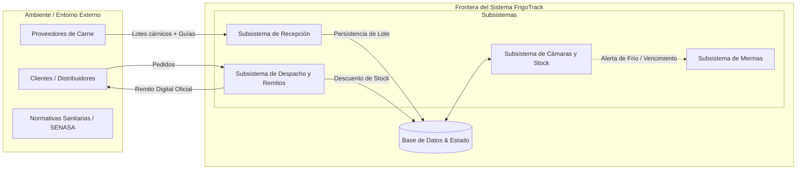
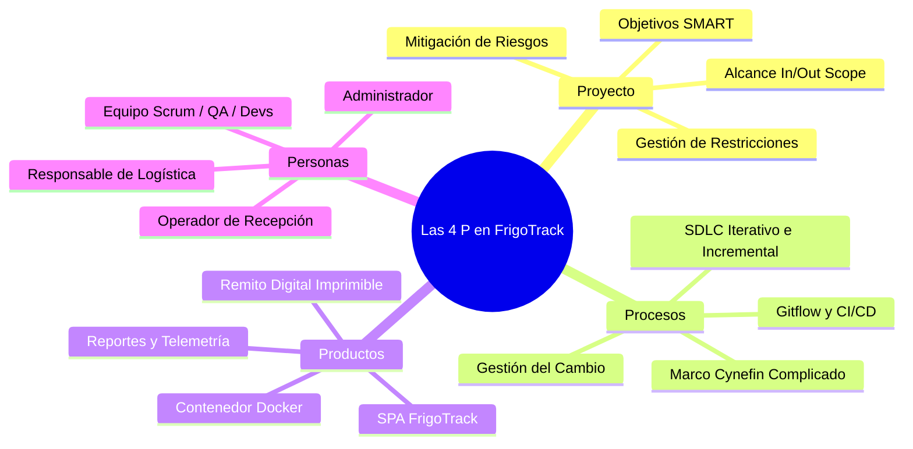
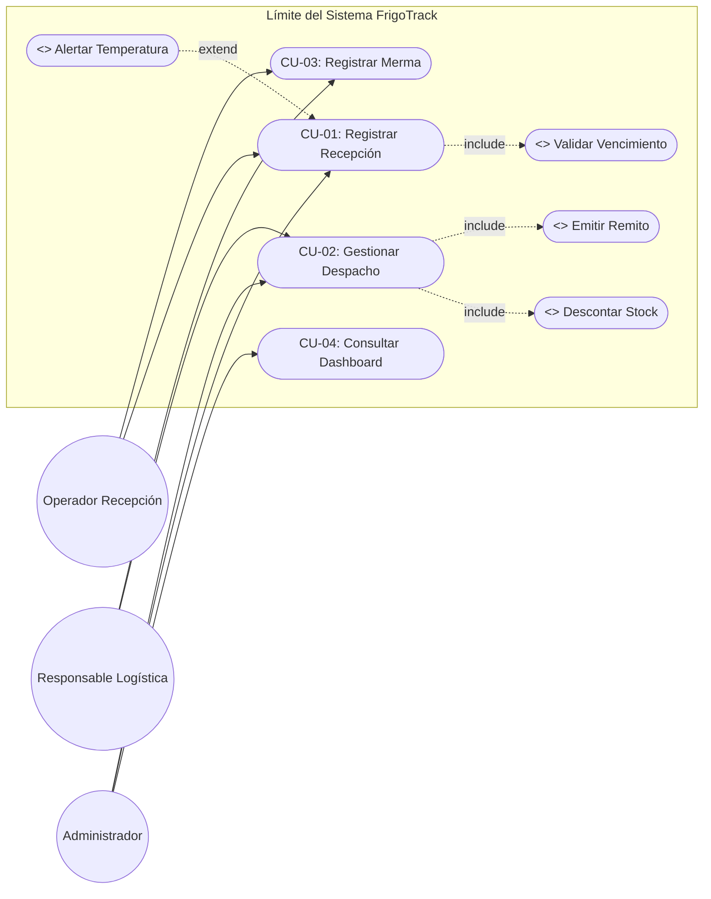
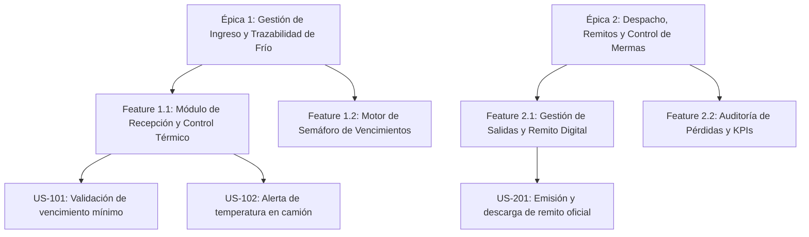
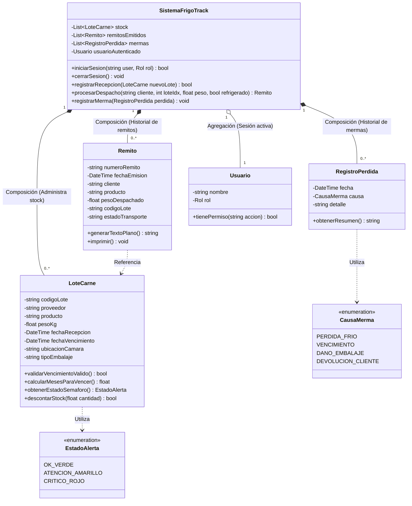
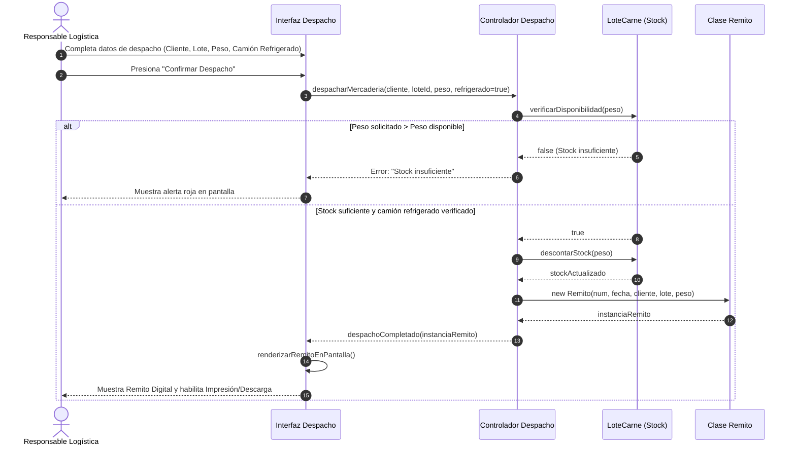
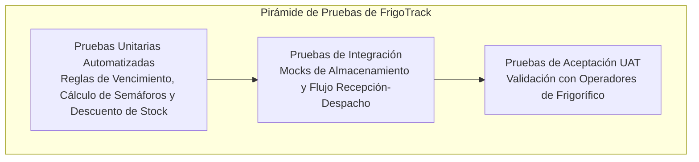

# ❄️ FrigoTrack — Sistema Integral de Gestión Logística y Trazabilidad en Cadena de Frío

> **Plataforma web para el control operativo, aseguramiento de temperatura, gestión de stock en cámaras frigoríficas y emisión automatizada de remitos de despacho para la industria cárnica.**

> **El presente proyecto se encuentra versión prototipo front-end. Cuenta únicamente con lógica del lado del cliente (sin back-end).**

> ### 🛠️ **La parte `back-end`, los `testings` unitarios y la `Dockerización` se encuentran en desarrollo. La documentación relativa a esos temas es `aspiracional`.**

[](https://github.com/ferlautaro2001/frigotrack/actions)
[](#8-estrategia-de-testing-y-control-de-calidad-qaqc)
[](#-contexto-acad%C3%A9mico)
[](CHANGELOG.md)
[](LICENSE)

---

## 🛠️ Tecnologías utilizadas en el estado actual:

### Frontend

<p align="left">
  
  
  
  
  
  
</p>

* JavaScript vanilla (ES6+, sin frameworks ni build step)
* [Chart.js](https://www.chartjs.org/) (v4.x) vía CDN para el gráfico de temperatura por cámara
* [Tailwind CSS](https://tailwindcss.com/) (v3.x) vía CDN para utilidades de maquetación y diseño responsive
* Iconografía [Lucide](https://lucide.dev/) embebida como sprite SVG en línea (trazo 1.5, 16 px), sin dependencias de fuentes de iconos
* Google Fonts (`Geist` + `Geist Mono`) para la interfaz y las cifras/lecturas de temperatura en modo tema oscuro (*Dark Theme*)

---

## 🏫 Contexto Académico
* **Institución:** Universidad Tecnológica Nacional – Facultad Regional Avellaneda (UTN FRA)
* **Carrera:** Tecnicatura Universitaria en Programación
* **Asignatura:** Metodología de Sistemas I
* **Equipo de Desarrollo:** Alumnos de la Cátedra

---

## 📑 Tabla de Contenidos
1. [Visión del Producto y Justificación del Negocio](#1-visión-del-producto-y-justificación-del-negocio)
2. [Dominio: Lenguaje Ubicuo](#2-dominio-lenguaje-ubicuo)
3. [Definición Sistémica (Teoría General de Sistemas - TGS)](#3-definición-sistémica-teoría-general-de-sistemas---tgs)
4. [Las 4 P del Desarrollo de Software](#4-las-4-p-del-desarrollo-de-software)
5. [Especificación de Requerimientos](#5-especificación-de-requerimientos)
6. [Casos de Uso del Proceso Unificado (RUP/UP)](#6-casos-de-uso-del-proceso-unificado-rupup)
7. [Gestión Ágil: Épicas, Features e Historias de Usuario](#7-gestión-ágil-épicas-features-e-historias-de-usuario)
8. [Diseño Orientado a Objetos y Modelado UML](#8-diseño-orientado-a-objetos-y-modelado-uml)
9. [Estrategia de Testing y Control de Calidad (QA/QC)](#9-estrategia-de-testing-y-control-de-calidad-qaqc)
10. [Cultura DevOps, Docker y Despliegue en la Nube](#10-cultura-devops-docker-y-despliegue-en-la-nube)
11. [Instalación y Puesta en Marcha](#11-instalación-y-puesta-en-marcha)
12. [Gobernanza del Proyecto y Matriz RACI](#12-gobernanza-del-proyecto-y-matriz-raci)

---

## 1. Visión del Producto y Justificación del Negocio

### 1.1. El Problema Raíz (Fase de Ideación / Design Thinking)
En la industria frigorífica y de distribución cárnica mayorista, la preservación de la **cadena de frío** ($\le -18^\circ\text{C}$) y la **trazabilidad de lotes** son factores críticos. Los registros analógicos o en planillas de cálculo dispersas originan:
1. **Pérdida de trazabilidad sanitaria**: Imposibilidad de auditar el origen, cámara y destino de cada lote.
2. **Mermas económicas por vencimientos no alertados**: Falta de rotación adecuada (PEPS/FIFO) y ausencia de alertas tempranas en cámara.
3. **Errores en recepción y despacho**: Carga incompleta de datos y omisión de controles de temperatura en transporte.
4. **Tiempos administrativos excesivos**: Confección manual de remitos que demora la salida de los camiones refrigerados.

### 1.2. Propuesta de Valor (MVP)
**FrigoTrack** centraliza y automatiza el ciclo operativo logístico mediante una arquitectura orientada a objetos:
* **Recepción Inteligente**: Validación estricta de fechas de vencimiento ($\ge 3$ meses) y advertencia de temperatura en camión.
* **Control de Stock y Cámaras**: Semáforo visual automatizado (*Rojo: < 2 meses*, *Atención: < 3 meses*, *OK: óptimo*) y codificación unívoca de lotes (`FT90XXX`).
* **Despacho y Remito Digital**: Descuento atómico de stock, validación obligatoria de camión refrigerado y generación instantánea de remito con opción de descarga e impresión.
* **Módulo de Mermas**: Clasificación de pérdidas por rotura, corte de frío o devolución para toma de decisiones.

---

## 2. Dominio: Lenguaje Ubicuo

En concordancia con los principios del **Diseño Guiado por el Dominio (DDD - Domain-Driven Design)**, se establece el siguiente glosario de términos clave para garantizar una terminología unívoca, rigurosa y compartida entre los desarrolladores, los analistas funcionales y los operadores de planta frigorífica:

| Concepto | Definición |
| :--- | :--- |
| **Cadena de Frío** | Conjunto ininterrumpido de procesos logísticos y térmicos que aseguran que los cortes cárnicos se mantengan constantemente a temperaturas reglamentarias ($\le -18\,^\circ\text{C}$ para congelados) desde la faena hasta la entrega al cliente final. |
| **Excursión Térmica** | Evento anómalo en el cual la temperatura de una cámara o unidad de transporte supera el umbral límite admisible ($-18\,^\circ\text{C}$), poniendo en riesgo la estabilidad microbiológica del lote y disparando alertas preventivas o bloqueos sanitarios. |
| **SENASA** | Servicio Nacional de Sanidad y Calidad Agroalimentaria (Argentina). Ente fiscalizador oficial que reglamenta las condiciones higiénico-sanitarias, la rotulación, el transporte y las temperaturas obligatorias para productos cárnicos de consumo interno y exportación. |
| **Lote Cárnico (`FT90XXX`)** | Unidad atómica de inventario y trazabilidad que agrupa un corte específico recibido en una fecha determinada, con peso neto en kilogramos, proveedor de origen, fecha de vencimiento y cámara asignada. |
| **Remito Oficial** | Documento mercantil y legal de amparo de tránsito (`R-XXXXXX`) que certifica la salida física de mercadería de la planta, registrando el cliente receptor, código de lote, kilogramos netos despachados y la validación de transporte refrigerado. |
| **Factura** | Documento contable, impositivo y fiscal de cobro (AFIP/ARCA) que acredita la transacción comercial y el valor monetario de la venta. En FrigoTrack se encuentra expresamente catalogada como **Out-of-Scope (Fase Futura)**, desacoplándose operativamente del remito logístico. |
| **Merma** | Pérdida de inventario no atribuible al despacho comercial. Representa mercadería descartada o inutilizable tipificada por causas formales: *Pérdida de frío*, *Vencimiento*, *Daño de embalaje* o *Devolución de cliente*. |
| **Semáforo de Vencimiento** | Algoritmo automatizado de categorización visual que clasifica los lotes en tres niveles de prioridad logística según los días/meses restantes para su caducidad: *Alerta roja* ($< 2$ meses), *Atención* ($< 3$ meses) y *OK* ($\ge 3$ meses). |
| **PEPS / FIFO** | Regla operativa de almacenamiento y rotación (*Primero Entrado, Primero Salido* / *First-In, First-Out*), que prioriza el despacho de los lotes más próximos a vencer para prevenir pérdidas biológicas y económicas. |
| **Descuento Atómico** | Operación transaccional sobre el inventario que deduce con precisión decimal los kilogramos solicitados en un despacho garantizando que nunca se produzcan inconsistencias de stock negativo ni sobreventas. |
| **Checklist de Muelle** | Procedimiento de control físico obligatorio previo a la descarga de un camión en muelle, que valida el precinto sanitario oficial, la higiene de la unidad y la lectura contrastada de temperatura por termómetro punzón. |
| **Cámara Frigorífica** | Espacio físico aislado térmicamente en planta, subdividido en sectores de estiba (ej. `Cámara 1 · Sector A`), con control telemétrico continuo de temperatura y capacidad de estiba medida en kilogramos. |

---

## 3. Definición Sistémica (Teoría General de Sistemas - TGS)

Siguiendo los principios de **Ludwig von Bertalanffy**, FrigoTrack se concibe como un **Sistema de Información Abierto y Dinámico**, compuesto por subsistemas interrelacionados que interactúan con su entorno:



### 2.1. Atributos Sistémicos del Proyecto
* **Teleología (Objetivo Central)**: Garantizar el 100% de trazabilidad de los cortes cárnicos, previniendo mermas por vencimiento o quiebre térmico y optimizando los despachos.
* **Límite / Frontera**: Inicia en la descarga en muelle de recepción y concluye con la emisión del remito de salida sobre camión refrigerado.
* **Entradas**: Proveedor, tipo de corte, peso neto (kg), fecha de faena/recepción, fecha de vencimiento, temperatura de transporte ($^\circ\text{C}$), estado de embalaje y datos del cliente.
* **Procesamiento**: Algoritmos de validación de plazos mínimos, cálculo temporal de vencimientos, descuento de stock en tiempo real y categorización de mermas.
* **Almacenamiento**: Estado centralizado de lotes en stock, historial de movimientos, remitos generados y registro de pérdidas.
* **Salidas**: Tablero de control de stock por cámara, remito digital estandarizado, alertas visuales y gráficas de métricas.
* **Homeostasis (Autorregulación)**: Reglas de validación que impiden procesar despachos con stock insuficiente o sin verificación de refrigeración.
* **Sinergia**: La integración entre recepción, monitoreo de cámaras y despacho garantiza que ningún lote vencido llegue al cliente final.
* **Retroalimentación (Feedback)**: Centro de notificaciones en tiempo real, KPIs dinámicos y paneles de mermas para la gerencia operativa.

### 2.2. Requisitos de la Información Eficiente
| Atributo | Implementación en FrigoTrack |
| :--- | :--- |
| **Exactitud** | Validación matemática en kg con decimales y cálculo estricto de fechas sin redondeos erróneos. |
| **Relevancia** | Cada rol visualiza únicamente la información operativa pertinente a su función. |
| **Oportunidad** | Alertas en rojo cuando un lote entra en el rango crítico de menos de 60 días para su caducidad. |
| **Integridad** | El remito no puede emitirse si falta el código de lote, el cliente o el peso validado. |
| **Claridad** | Interfaz con tipografía accesible, contrastes legibles y código de colores semafórico estándar. |
| **Consistencia** | La misma codificación de lote (`FT90XXX`) se mantiene en stock, despacho y remito. |
| **Accesibilidad** | Aplicación web multidispositivo con navegación responsive y soporte para impresión local. |
| **Confiabilidad** | Registro inmutable de transacciones y estados controlados por roles autorizados. |

---

## 4. Las 4 P del Desarrollo de Software



### 3.1. Proyecto (Gestión, Alcance y Objetivos SMART)
* **Objetivos SMART y Métricas de Éxito**:
  1. **Reducción de errores de carga**: Lograr que el **95%** de las recepciones cuenten con checklist térmico completo en **8 semanas**.
  2. **Prevención de mermas**: Reducir a **0** la cantidad de lotes que alcancen fecha de caducidad en cámara sin alerta previa en **2 meses**.
  3. **Trazabilidad de despacho**: Alcanzar el **100%** de despachos con lote y validación de frío en **6 semanas**.
  4. **Eficiencia operativa**: Reducir el tiempo de emisión de remitos a **menos de 3 minutos** por operación.
* **Alcance**:
  * **In-Scope**: Autenticación por roles, recepción cárnica, gestión de cámaras, cálculo de vencimientos, despacho, remito digital y registro de pérdidas.
  * **Out-of-Scope (Fases Futuras)**: Facturación electrónica AFIP/ARCA directa, integración telemática IoT con sensores de hardware en camiones vía satélite.

### 3.2. Procesos (Metodología y Ciclo de Vida)
* **Marco Cynefin**: El dominio de FrigoTrack es **Complicado** (requiere análisis técnico de reglas de negocio cárnicas, buenas prácticas de ingeniería y modelado orientado a objetos con expertos).
* **Ciclo de Vida del Software**: **Iterativo e Incremental (Proceso Unificado / RUP)** articulado con **Scrum** en sprints de 2 semanas.

### 3.3. Productos (Entregables)
* Código fuente estructurado y desacoplado (HTML5 semántico, CSS Tailwind, JavaScript ES6+ modular).
* Contenedor Docker listo para producción (`Dockerfile` + `docker-compose.yml`).
* Documentación técnica completa (Casos de Uso, Diagrama de Clases UML, Plan de Pruebas y Matriz RACI).

### 3.4. Personas (Organización y Roles)
* **Roles de Negocio**: Administrador del Sistema, Operador de Recepción, Responsable de Despacho/Logística.
* **Roles de Ingeniería**: Analistas Funcionales, Arquitecto de Software, Desarrolladores Frontend/Backend, Líder de QA y Especialista DevOps.

---

## 5. Especificación de Requerimientos

### 4.1. Requerimientos Funcionales (RF)
| ID | Nombre | Descripción | Prioridad |
| :---: | :--- | :--- | :---: |
| **RF-01** | **Control de Acceso y Roles** | El sistema debe permitir el ingreso diferenciado por rol (Administrador, Recepción, Logística) mostrando el perfil activo y restringiendo acciones no autorizadas. | Alta |
| **RF-02** | **Registro de Recepción** | Permitir la carga de proveedor, corte de carne, peso en kg, fecha de recepción, fecha de vencimiento, ubicación en cámara y estado de embalaje. | Alta |
| **RF-03** | **Validación de Vida Útil Mínima** | Validar que la fecha de vencimiento del lote ingresado sea superior a 3 meses respecto de la fecha de recepción; rechazar el registro en caso contrario. | Crítica |
| **RF-04** | **Control Térmico de Recepción** | Registrar la temperatura del camión de entrega. Si supera los $-18^\circ\text{C}$, emitir advertencia preventiva y requerir confirmación explícita. | Alta |
| **RF-05** | **Semáforo de Alertas de Stock** | Calcular automáticamente el estado de los lotes: *Alerta Roja* ($< 2$ meses), *Atención* ($< 3$ meses) y *OK* ($\ge 3$ meses). | Alta |
| **RF-06** | **Despacho y Descuento de Stock** | Permitir seleccionar un lote disponible, verificar stock suficiente, descontar el peso solicitado de manera atómica y registrar el cliente receptor. | Crítica |
| **RF-07** | **Validación de Cadena de Frío en Despacho** | Exigir la confirmación de carga en camión refrigerado antes de autorizar la salida de mercadería. | Crítica |
| **RF-08** | **Emisión de Remito Digital** | Generar un remito numerado correlativo (`R-XXXXXX`) con datos del cliente, lote, peso, fecha y confirmación de frío, con soporte para impresión y exportación `.txt`. | Alta |
| **RF-09** | **Registro y Clasificación de Mermas** | Registrar pérdidas de mercadería categorizadas por causa (*Pérdida de frío*, *Vencimiento*, *Daño de embalaje*, *Devolución cliente*) e impactar los gráficos estadísticos. | Media |

### 4.2. Requerimientos No Funcionales (RNF)
* **RNF-01 (Rendimiento)**: Tiempo de procesamiento de formularios y actualización de tablas $< 100\text{ ms}$ en cliente.
* **RNF-02 (Seguridad)**: Sanitización estricta de entradas para prevenir inyecciones y aislamiento de sesiones locales.
* **RNF-03 (Disponibilidad y Confiabilidad)**: Operabilidad garantizada del 99.9% en despliegues sobre infraestructura Cloud.
* **RNF-04 (Usabilidad y Accesibilidad)**: Diseño responsive optimizado para terminales de depósito, tablets y escritorios, con semáforos de alto contraste.
* **RNF-05 (Portabilidad)**: Ejecución multiplataforma mediante empaquetado estándar en contenedores Docker.

---

## 6. Casos de Uso del Proceso Unificado (RUP/UP)

### 5.1. Diagrama General de Casos de Uso (UML)



---

### 5.2. Especificaciones Detalladas de Casos de Uso

#### CU-01: Registrar Recepción de Mercadería
* **Actor Principal:** Operador de Recepción / Administrador.
* **Nivel:** Extendido.
* **Precondiciones:** Operador autenticado en el sistema.
* **Postcondiciones:** Lote ingresado en stock con código único (`FT90XXX`), estado de semáforo calculado e incremento del contador de recepciones.

```text
Flujo Principal:
1. El Operador ingresa al módulo de Recepción.
2. Completa los datos: Proveedor, Producto, Peso (kg), Ubicación de Cámara, Fecha Recepción, Fecha Vencimiento, Tipo de Embalaje y Temperatura del Camión.
3. Presiona el botón "Registrar Recepción".
4. El sistema valida que la Fecha de Vencimiento sea al menos 3 meses posterior a la Fecha de Recepción.
5. El sistema verifica que la temperatura del camión sea <= -18°C.
6. El sistema genera el código de lote, almacena el nuevo registro en el stock activo y actualiza los KPIs del Dashboard.
7. El sistema muestra un mensaje de confirmación exitosa y resetea el formulario.

Flujos Alternativos:
- A1 (Temperatura fuera de rango óptimo): En el paso 5, si la temperatura es > -18°C, el sistema solicita confirmación mediante advertencia ("Temperatura superior a -18°C. ¿Desea registrar con alerta?"). Si el operador confirma, se registra con marca de advertencia; si cancela, se detiene el registro.

Flujos de Excepción:
- E1 (Vencimiento inferior a 3 meses): En el paso 4, si la fecha de vencimiento no cumple el plazo mínimo de 3 meses, el sistema bloquea el registro, resalta el campo en rojo y muestra el mensaje: "Error: el vencimiento debe ser mínimo 3 meses luego de la recepción".
- E2 (Campos obligatorios incompletos): Si falta algún dato mandatorio, el sistema indica los campos requeridos y cancela la operación.
```

---

#### CU-02: Gestionar Despacho y Emisión de Remito
* **Actor Principal:** Responsable de Logística / Administrador.
* **Nivel:** Extendido.
* **Precondiciones:** Existencia de stock disponible en cámaras de frío.
* **Postcondiciones:** Stock actualizado con descuento atómico del peso despachado, remito digital generado y disponible para descarga/impresión.

```text
Flujo Principal:
1. El Responsable de Logística accede a la pantalla de Despacho.
2. Selecciona el lote/producto desde el listado desplegable de stock disponible.
3. Ingresa el Nombre del Cliente, el Peso a despachar (kg) y el Código de Lote.
4. Marca la casilla obligatoria de "Carga en camión refrigerado confirmada".
5. Presiona "Confirmar Despacho".
6. El sistema valida que el peso solicitado sea <= al peso existente en el lote seleccionado.
7. El sistema verifica la confirmación de camión refrigerado.
8. El sistema descuenta el peso del stock y genera un número de remito correlativo (R-XXXXXX).
9. El sistema redirige automáticamente a la pantalla del Remito Digital con todos los datos cargados.

Flujos de Excepción:
- E1 (Stock Insuficiente): En el paso 6, si el peso a despachar supera el disponible, el sistema cancela el despacho y muestra: "Stock insuficiente. Disponible: X kg".
- E2 (Falta de confirmación de cadena de frío): En el paso 7, si no se tildó la confirmación de camión refrigerado, el sistema interrumpe el proceso informando: "Debe confirmar carga en camión refrigerado".
```

---

## 7. Gestión Ágil: Épicas, Features e Historias de Usuario

### 6.1. Jerarquía de Descomposición



### 6.2. Historias de Usuario con Criterios de Aceptación (BDD)

### US-101: Validación Automática de Vencimiento en Recepción
* **Épica:** Gestión de Ingreso y Trazabilidad
* **Estimación:** 3 Story Points | **Prioridad:** Crítica

**Como** Operador de Recepción,  
**Quiero** que el sistema verifique automáticamente que la fecha de caducidad sea al menos 3 meses mayor a la de ingreso,  
**Para** evitar almacenar cortes con riesgo inminente de descomposición o vencimiento no comercializable.

#### Criterios de Aceptación (Given-When-Then):
- [ ] **Escenario 1: Fecha válida (>= 3 meses)**
  - *Dado que* ingreso una fecha de recepción "2026-05-01" y un vencimiento "2026-09-01",
  - *Cuando* presiono "Registrar Recepción",
  - *Entonces* el sistema acepta el registro y lo agrega al stock con estado "OK".
- [ ] **Escenario 2: Fecha inválida (< 3 meses)**
  - *Dado que* ingreso una fecha de recepción "2026-05-01" y un vencimiento "2026-06-15",
  - *Cuando* presiono "Registrar Recepción",
  - *Entonces* el sistema bloquea el guardado y muestra alerta visual roja indicando la violación de la regla de los 3 meses.

---

## 8. Diseño Orientado a Objetos y Modelado UML

### 7.1. Diagrama de Clases del Dominio (UML)



---

### 7.2. Diagrama de Secuencia UML: Proceso de Despacho y Remito



---

## 9. Estrategia de Testing y Control de Calidad (QA/QC)

El plan de aseguramiento de calidad de FrigoTrack implementa estrategias de **Shift-Left** (pruebas unitarias automatizadas) y **Shift-Right** (telemetría en producción y pruebas de humo).



### 8.1. Matriz de Trazabilidad de Pruebas
| Requerimiento | Caso de Uso | Nivel de Prueba | Archivo de Test | Tipo de Prueba | Estado |
| :--- | :--- | :--- | :--- | :--- | :---: |
| **RF-03 (Vencimiento $\ge 3$ meses)** | `CU-01` | Unitaria | `tests/unit/vencimiento.test.js` | Caja Blanca | ✅ Pass |
| **RF-04 (Temperatura Camión)** | `CU-01` | Unitaria | `tests/unit/temperatura.test.js` | Caja Blanca | ✅ Pass |
| **RF-05 (Semáforo de Alertas)** | `CU-01 / CU-04`| Unitaria | `tests/unit/semaforo.test.js` | Caja Blanca | ✅ Pass |
| **RF-06 (Descuento de Stock)** | `CU-02` | Integración | `tests/integration/despacho.test.js` | Caja Negra | ✅ Pass |
| **RF-07 (Refrigeración Despacho)**| `CU-02` | Integración | `tests/integration/remito.test.js` | Caja Negra | ✅ Pass |
| **RNF-01 (Tiempo de Respuesta)** | `Todos` | Sistema / Carga | `tests/performance/load.test.js` | Rendimiento | ✅ Pass |

### 8.2. Comandos de Ejecución de Pruebas
```bash
# Ejecutar suite de pruebas unitarias
npm run test:unit

# Ejecutar pruebas de integración con reporte de cobertura
npm run test:coverage
```

---

## 10. Cultura DevOps, Docker y Despliegue en la Nube

### 10.1. Pipeline de Integración Continua (`.github/workflows/ci.yml`)
En cada *Push* o *Pull Request* hacia la rama principal, GitHub Actions ejecuta el pipeline automatizado:
1. **Linter & Syntax Check**: Validación de formato y buenas prácticas.
2. **Automated Testing**: Ejecución de las suites unitarias y de integración.
3. **Build Verification**: Verificación de empaquetado de artefactos estáticos.

---

### 10.2. Infraestructura Inmutable con Docker

#### `Dockerfile`:
```dockerfile
FROM nginx:alpine
LABEL maintainer="UTN FRA - Metodología de Sistemas I"
COPY . /usr/share/nginx/html
EXPOSE 80
CMD ["nginx", "-g", "daemon off;"]
```

#### `docker-compose.yml`:
```yaml
version: '3.8'

services:
  frigotrack-app:
    build: .
    container_name: frigotrack-app
    ports:
      - "8080:80"
    restart: always
    environment:
      - NODE_ENV=production
```

---

### 10.3. Justificación de Topología Cloud
* **Modelo**: Despliegue en **PaaS** (plataformas de contenedores como AWS App Runner, Azure Container Apps o Render) o **IaaS** (instancia Linux VPS aislada).
* **Beneficios**: Alta disponibilidad, escalabilidad ante picos estacionales de faena, redundancia de datos y baja latencia de respuesta para terminales en planta.

---

## 11. Instalación y Puesta en Marcha

### 11.1. Requisitos Previos
* **Git** instalado ($\ge 2.30$)
* **Docker** y **Docker Compose** (opcional, para despliegue aislado) o cualquier servidor web local.

### 11.2. Ejecución con Docker (Recomendado)
```bash
# 1. Clonar el repositorio
git clone https://github.com/ferlautaro2001/frigotrack.git
cd frigotrack

# 2. Construir y levantar el contenedor
docker compose up -d --build

# 3. Acceder desde el navegador
# Abrir: http://localhost:8080
```

### 11.3. Ejecución Local Directa
Simplemente abra el archivo `index.html` en cualquier navegador web moderno (Google Chrome, Mozilla Firefox, Microsoft Edge).

---

## 12. Gobernanza del Proyecto y Matriz RACI

Para asegurar una clara división de responsabilidades durante todo el ciclo de desarrollo, el equipo adopta la siguiente matriz de responsabilidades:

> **R (Responsible)**: Quien ejecuta la tarea | **A (Accountable)**: Quien aprueba y responde | **C (Consulted)**: Quien asesora | **I (Informed)**: Quien recibe notificación

| Actividad / Entregable | Analista Funcional | Arquitecto | Desarrollador | QA / Tester | DevOps | Docente / Cátedra |
| :--- | :---: | :---: | :---: | :---: | :---: | :---: |
| **Definición de Requerimientos y Casos de Uso** | **R / A** | C | I | C | I | **A** |
| **Modelado de Clases y Arquitectura UML** | C | **R / A** | C | I | I | **A** |
| **Implementación Frontend y Reglas de Negocio** | I | C | **R / A** | C | I | I |
| **Diseño y Ejecución de Plan de Pruebas** | C | I | C | **R / A** | I | **A** |
| **Automatización CI/CD y Dockerización** | I | C | I | C | **R / A** | I |
| **Auditoría Final y Entrega del Repositorio** | **R** | **R** | **R** | **R** | **R** | **A** |

---

## 📄 Licencia
Este proyecto está distribuido bajo los términos de la Licencia MIT. Consulte el archivo [LICENSE](LICENSE) para más detalles.

---
*FrigoTrack — Desarrollado bajo los estándares de ingeniería de software de la cátedra Metodología de Sistemas I (UTN FRA).*